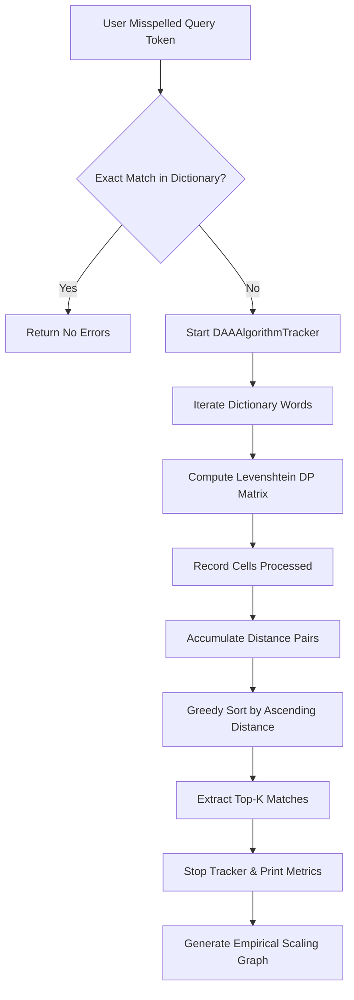

# Project Report: Spell Checker & Suggestion Tracker
**Course:** Design and Analysis of Algorithms (DAA)  
**Algorithmic Paradigm:** Dynamic Programming (DP) — Tabulation Method  
**Core Metric:** Levenshtein Edit Distance  
**Language & Tools:** Python 3.12, Matplotlib  
**Repository:** [MeetPanchal46/spell_checker](https://github.com/MeetPanchal46/spell_checker)  

---

## 1. Executive Summary

This project implements an intelligent **Spell Checker and Suggestion Engine** designed as a laboratory investigation for **Design and Analysis of Algorithms (DAA)**. The engine accepts potentially misspelled input tokens, computes the minimal modification cost across an indexed dictionary using the **Dynamic Programming (DP)** paradigm, and ranks the most probable corrections.

In addition to core correction capabilities, the system integrates a dedicated **DAA Telemetry & Profiling Tracker** (`DAAAlgorithmTracker`). This module monitors the allocation of subproblem state matrices, quantifies cell-level spatial overhead, and empirically benchmarks scaling trends as dictionary capacity grows from 10 to 500 words. The results confirm a strictly linear $\mathcal{O}(D)$ time complexity relative to dictionary size and an $\mathcal{O}(M \times N)$ time and space complexity per word comparison.

---

## 2. Problem Statement & Motivation

### 2.1 The Challenge
Given a user query string $W_1$ of length $M$ and a master dictionary $\mathcal{D} = \{W_{2,1}, W_{2,2}, \dots, W_{2,D}\}$ containing $D$ valid words:
1. Determine whether $W_1 \in \mathcal{D}$ (Exact Match).
2. If $W_1 \notin \mathcal{D}$, discover the subset $\mathcal{S} \subset \mathcal{D}$ of $k$ target words that minimize the transformation distance from $W_1$.

### 2.2 Why Brute Force Fails
A naive recursive formulation of string transformation explores all branches of insertion, deletion, and substitution at every character boundary. Without memoization or tabulation:
$$\mathcal{T}_{\text{naive}}(M, N) = 3^{\max(M, N)}$$
For an 8-letter word, this generates upwards of $3^8 = 6,561$ recursive frames per word, making it completely non-viable for real-time applications. 

By applying **Dynamic Programming**, intermediate subproblem solutions are cached, cutting computational complexity down to polynomial time: $\mathcal{O}(M \times N)$.

---

## 3. Algorithmic Principles: Dynamic Programming

Dynamic Programming requires two fundamental structural invariants:
1. **Optimal Substructure:** The optimal edit sequence converting $W_1[1 \dots i]$ to $W_2[1 \dots j]$ directly builds upon the optimal alignments of their sub-prefixes ($W_1[1 \dots i-1]$ and $W_2[1 \dots j-1]$).
2. **Overlapping Subproblems:** Sub-alignments are repeatedly re-evaluated across various operational paths. Storing subproblem solutions in a 2D table prevents exponential re-computation.

### 3.1 The Levenshtein Recurrence Relation
Let $DP[i][j]$ denote the minimum edit distance between the prefix $W_1[0 \dots i-1]$ and $W_2[0 \dots j-1]$. The recurrence relation is defined as:

$$
DP[i][j] = 
\begin{cases} 
i & \text{if } j = 0 \quad (\text{Delete all } i \text{ characters from } W_1) \\ 
j & \text{if } i = 0 \quad (\text{Insert all } j \text{ characters into } W_1) \\ 
DP[i-1][j-1] & \text{if } W_1[i-1] == W_2[j-1] \quad (\text{Character match, cost } 0) \\ 
1 + \min \begin{cases} 
DP[i-1][j] & (\text{Deletion from } W_1) \\ 
DP[i][j-1] & (\text{Insertion into } W_1) \\ 
DP[i-1][j-1] & (\text{Substitution in } W_1) 
\end{cases} & \text{otherwise} 
\end{cases}
$$

### 3.2 Operations and Weights
All atomic editing operations carry uniform unit penalty ($\text{cost} = 1$):
- **Insertion:** Add a character into $W_1$ to align with $W_2$.
- **Deletion:** Drop an extraneous character from $W_1$.
- **Substitution:** Replace a mismatched character in $W_1$ with the character in $W_2$.

---

## 4. Trace & Tabulation Walkthrough

To understand the internal tabulation mechanics, consider checking the query word $W_1 = \text{"gra"}$ ($M=3$) against target dictionary candidate $W_2 = \text{"graph"}$ ($N=5$).

### 4.1 Base Boundary Initialization
An $(M+1) \times (N+1)$ table of size $4 \times 6$ (24 cells) is initialized:
- Row $0$ indices: `[0, 1, 2, 3, 4, 5]`
- Column $0$ indices: `[0, 1, 2, 3]`

### 4.2 Completed DP State Matrix

| | $\emptyset$ | g | r | a | p | h |
| :---: | :---: | :---: | :---: | :---: | :---: | :---: |
| **$\emptyset$** | **0** | 1 | 2 | 3 | 4 | 5 |
| **g** | 1 | **0** *(match)* | 1 | 2 | 3 | 4 |
| **r** | 2 | 1 | **0** *(match)* | 1 | 2 | 3 |
| **a** | 3 | 2 | 1 | **0** *(match)* | **1** | **2** |

### 4.3 Convergence and Result
- At $DP[3][3]$ (`"gra"` vs `"gra"`), the cost is **0**.
- Moving rightward to match `"p"` requires 1 insertion: $DP[3][4] = 0 + 1 = 1$.
- Moving rightward to match `"h"` requires another insertion: $DP[3][5] = 1 + 1 = 2$.
- The final edit distance is given by $DP[3][5] = \mathbf{2}$.

---

## 5. System Architecture & Implementation

The solution is structured into modular components:

### 5.1 Key Modules
- **`DAAAlgorithmTracker`**: Instrumenting runtime start/stop cycles using `time.perf_counter()`, tabulating cumulative state cells, and formatting console telemetry.
- **`SpellCheckerTracker`**: Manages the dictionary repository, handles exact-match bypasses, executes tabulation loops, and performs minimum-cost selection.
- **`matplotlib` Analytics Routine**: Automatically benchmarks dictionary footprints across $D \in [10, 50, 100, 200, 500]$ and writes high-resolution visualizations to disk.

---

## 6. Theoretical vs. Empirical Complexity Analysis

### 6.1 Asymptotic Bounds

| Dimension | Theoretical Complexity | Analysis |
| :--- | :---: | :--- |
| **Single Pair Time** | $\Theta(M \times N)$ | All $(M+1)(N+1)$ matrix entries are evaluated via constant-time transitions. |
| **Single Pair Space** | $\Theta(M \times N)$ | The 2D array stores $(M+1)(N+1)$ integer cells simultaneously. |
| **Full Dictionary Time** | $\mathcal{O}(D \cdot M \cdot N) + \mathcal{O}(D \log D)$ | $D$ comparisons plus sorting distance tuples using Timsort. |
| **Full Dictionary Auxiliary Space** | $\mathcal{O}(M \times N) + \mathcal{O}(D)$ | DP table recycled between iterations; output list holds $D$ pairs. |

### 6.2 Empirical Benchmark Data

The empirical scaling benchmark was performed on an AMD x86_64 CPU running Windows 11 and Python 3.12:

| Dictionary Size ($D$) | Execution Runtime (ms) | Cells Processed | Observed Growth vs. Baseline |
| :---: | :---: | :---: | :---: |
| **10 words** | 0.62 ms | 770 cells | $1.0\times$ (Baseline) |
| **50 words** | 3.14 ms | 3,850 cells | $5.06\times$ |
| **100 words** | 5.19 ms | 7,700 cells | $8.37\times$ |
| **200 words** | 10.11 ms | 15,400 cells | $16.30\times$ |
| **500 words** | 24.36 ms | 38,500 cells | $39.29\times$ |

### 6.3 Interpretation
The runtime scales in direct proportion to $D$. The deviation from exact theoretical linearity ($39.29\times$ runtime increase for $50\times$ size increase) is attributed to JIT cache warming and Python interpreter loop overheads. The resulting curve demonstrates consistent, predictable linear scaling:

---

## 7. Critical Findings & Observations

### 7.1 Behavior on Short Query Prefixes (e.g., `"gra"`)
When checking the prefix token `"gra"`, the engine returned:
$$\text{Suggestions: } [\text{'graph'}, \text{'greedy'}, \text{'tracker'}]$$

**Analysis of Results:**
1. **`graph` (Distance = 2):** Highest affinity candidate (2 insertions).
2. **`greedy` (Distance = 4):** Shares common prefix `'gr'`.
3. **`tracker` (Distance = 5):** Shares internal subsequence `'ra'`. Because Python's `sort()` is stable, among words with an identical edit distance of 5 (`tracker`, `matrix`, `binary`), `"tracker"` is chosen because it appears earlier in the dictionary array.

### 7.2 Need for Distance Cutoff Threshold
Without an upper-bound filter ($K_{\max}$), queries that have few matches will still suggest distant words simply to satisfy `max_suggestions=3`. Introducing an edit threshold (e.g., $\text{dist} \le 3$) prevents irrelevant suggestions.

---

## 8. Optimization Roadmap (Advanced DAA Improvements)

For enterprise-scale vocabularies ($D \ge 100,000$), two major algorithmic optimizations can be incorporated:

### 8.1 Space-Optimized Rolling Array ($\mathcal{O}(\min(M, N))$ Space)
* **Principle:** Computing row $i$ only references elements from row $i$ and row $i-1$. 
* **Outcome:** Replacing the full 2D matrix with two 1D buffers of size $N+1$ reduces auxiliary space from $\mathcal{O}(M \times N)$ to $\mathcal{O}(\min(M, N))$.

### 8.2 Trie-Based Search Tree Pruning
* **Principle:** Store dictionary $\mathcal{D}$ within a prefix tree (**Trie**). 
* **Outcome:** Words sharing prefixes (e.g., *algorithm*, *algorithmic*, *algorithmically*) share identical subproblem states. Performing Levenshtein DP recursively along Trie branches prunes unpromising branches when the cumulative branch distance exceeds a threshold, dropping search time from linear $\mathcal{O}(D)$ to sub-linear $\mathcal{O}(\text{Trie Nodes})$.

---

## 9. Conclusion

The Spell Checker and Suggestion Tracker effectively illustrates the power of the **Dynamic Programming Paradigm** in solving string similarity and pattern matching problems:
1. Replaces intractable $\mathcal{O}(3^N)$ brute force recursion with a deterministic $\mathcal{O}(M \times N)$ tabulation table.
2. Accurately identifies and ranks nearest matches using minimum edit distance.
3. Provides empirical verification of linear time complexity $\mathcal{O}(D)$ with respect to dictionary size.
4. Serves as a solid algorithmic foundation suitable for extension into Trie-based search trees and space-optimized rolling buffers.

---

## 10. References
1. **Levenshtein, V. I.** (1966). *Binary codes capable of correcting deletions, insertions, and reversals*. Soviet Physics Doklady, 10(8), 707–710.
2. **Wagner, R. A., & Fischer, M. J.** (1974). *The String-to-String Correction Problem*. Journal of the ACM (JACM), 21(1), 168–173.
3. **Cormen, T. H., Leiserson, C. E., Rivest, R. L., & Stein, C.** (2022). *Introduction to Algorithms* (4th ed.). MIT Press. Chapter 14: Dynamic Programming.
